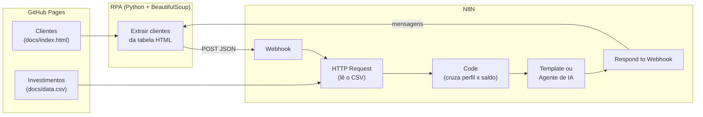
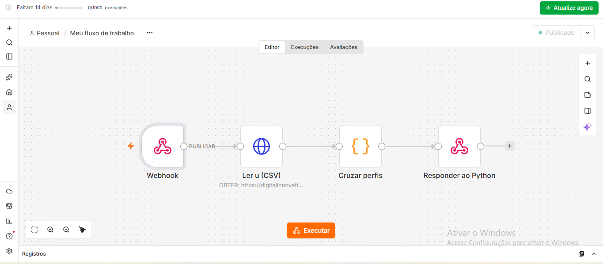
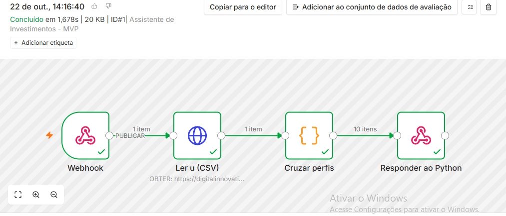
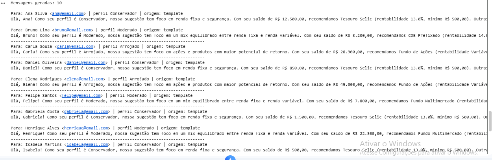

# 🤖 Assistente de Investimentos com RPA, N8N e IA Generativa

Solução do desafio **"Criando um Processo de RPA com N8N e Python"** da [DIO](https://www.dio.me/), na trilha Santander Automação com N8N.

Um robô em Python lê a lista de clientes de uma página web, envia os dados para um workflow no N8N, que cruza o perfil de cada cliente com uma base de investimentos e devolve uma mensagem de recomendação personalizada para cada um.

## ✅ Entregáveis

| Item | Onde está | Status |
|---|---|---|
| Script de RPA integrado ao Webhook | [`rpa/extrair_clientes.ipynb`](rpa/extrair_clientes.ipynb) | ✅ |
| Workflow MVP com mensagens estáticas | [`n8n/workflow.json`](n8n/workflow.json) | ✅ |
| Workflow com Agente de IA (desafio completo) | [`n8n/workflow-ia.json`](n8n/workflow-ia.json) | ✅ |
| Documentação das decisões técnicas | este README | ✅ |
| Prints do fluxo funcionando | [`prints/`](prints/) | ✅ |

## 🏗️ Arquitetura



### Workflow MVP (`n8n/workflow.json`)

`Webhook` → `Ler investimentos (CSV)` → `Cruzar perfis` → `Responder ao Python`

### Workflow com IA (`n8n/workflow-ia.json`)

`Webhook` → `Ler investimentos (CSV)` → `Cruzar perfis` → `Agente de IA` (+ `Google Gemini`) → `Montar resposta` → `Responder ao Python`

## 📁 Estrutura

```
📁 dio-lab-assistente-investimentos-rpa-n8n/
├── 📄 README.md
├── 📁 rpa/
│   └── 📄 extrair_clientes.ipynb   # robô de extração + envio ao Webhook
├── 📁 n8n/
│   ├── 📄 workflow.json            # MVP: mensagens por template
│   └── 📄 workflow-ia.json         # desafio: mensagens geradas por LLM
├── 📁 docs/
│   ├── 📄 index.html               # página de clientes (GitHub Pages)
│   └── 📄 data.csv                 # opções de investimento por perfil
└── 📁 prints/                      # evidências do fluxo funcionando
```

## ▶️ Como executar

1. **Importe o workflow no N8N.** No N8N (Cloud ou local), crie um workflow e use **⋯ → Import from File** com `n8n/workflow.json` (ou `workflow-ia.json`).
2. **(Só na versão com IA) Configure o Gemini.** Abra o nó **Google Gemini**, crie uma credencial com uma API key gerada no [Google AI Studio](https://aistudio.google.com/) e, se quiser, escolha outro modelo na lista.
3. **Pegue a URL do Webhook.** Abra o nó **Webhook** e copie a URL:
   - *Test URL* (`/webhook-test/...`): clique em **Listen for test event** antes de rodar o Python.
   - *Production URL* (`/webhook/...`): funciona com o workflow **ativado** (botão *Active*).
4. **Rode o robô no Colab.** Abra `rpa/extrair_clientes.ipynb` no Google Colab, cole a URL em `N8N_WEBHOOK` e execute todas as células.
5. **Confira o resultado.** O notebook imprime a mensagem de cada cliente, e a aba **Executions** do N8N mostra o caminho dos dados nó a nó.

## 🧠 Decisões técnicas

**Payload no formato `{"clientes": [...]}`.** O robô manda todos os clientes numa única requisição, e não uma por cliente. Assim o N8N lê o CSV uma vez só por execução, e o resultado volta inteiro na mesma resposta. O nó Code também aceita o array puro, caso alguém envie sem a chave `clientes`.

**CSV lido via HTTP Request, direto do GitHub Pages.** A base de investimentos fica num só lugar: ao editar o `data.csv` no repositório, o workflow já usa a versão nova, sem mexer no N8N.

**Cruzamento em um nó Code, e não em Merge.** O cruzamento não é um "join" simples por chave, porque além do perfil também precisa respeitar o saldo. Em JavaScript isso cabe em poucas linhas e fica mais legível do que vários nós encadeados. A lógica:
1. converte o saldo de texto (`"R$ 12.500,00"`) para número;
2. filtra os produtos **do mesmo perfil** cujo **mínimo cabe no saldo**;
3. escolhe o destaque: o de **maior taxa fixa**; se todos forem de renda variável, o de **maior aplicação mínima** que o cliente consegue fazer (ex.: Fundo de Ações para quem tem saldo);
4. monta a mensagem a partir do template do perfil.

**Templates por perfil (MVP).**
- *Conservador*: renda fixa e segurança.
- *Moderado*: mix entre renda fixa e variável.
- *Arrojado*: ações e maior potencial de retorno.

**Casos de borda tratados.** Se o perfil for desconhecido, a mensagem pede para o cliente atualizar o questionário, sem arriscar uma recomendação. Se o saldo não alcançar nenhum mínimo do perfil, a mensagem incentiva novos aportes em vez de sugerir algo que ele não pode comprar.

**Agente de IA com dados "mastigados".** A IA não lê o CSV nem decide sozinha quais produtos cabem no saldo. Ela recebe do nó Code apenas as opções já filtradas, com taxa e mínimo. O *system message* proíbe inventar produtos ou taxas e prometer ganhos garantidos, e limita o tamanho do texto. Isso reduz bastante o risco de alucinação, o que é crítico num contexto financeiro.

**Plano B se a IA falhar.** O nó do agente está com *On Error → Continue*. Se a IA der erro (cota, chave inválida) ou responder vazio, o nó **Montar resposta** usa a mensagem do template. O campo `origem` (`ia` ou `template`) mostra qual texto foi usado.

**Ajustes no robô.** Além de resolver o TODO de envio, adicionei `timeout` e `raise_for_status()` nas requisições, para o script falhar com erro claro em vez de travar. Também passei os bytes da página (`.content`) ao BeautifulSoup, que respeita o `<meta charset="utf-8">`: com `.text`, se o servidor não informar a codificação, nomes como "João" podem virar "João".

## 💬 Exemplo de saída (MVP)

```text
Para: Ana Silva <ana@email.com> | perfil Conservador | origem: template
Olá, Ana! Como seu perfil é Conservador, nossa sugestão tem foco em renda fixa e segurança.
Com seu saldo de R$ 12.500,00, recomendamos Tesouro Selic (rentabilidade 13.0%, mínimo R$ 500,00).
Outras opções do seu perfil que cabem no seu saldo: CDB Liquidez Diária, Poupança.
São opções de baixo risco, ideais para proteger seu patrimônio e manter liquidez.
```

## 📸 Prints

### Workflow no N8N


### Execução concluída: 1 requisição com os clientes, 10 mensagens geradas


### Saída do robô no Google Colab


## 🛠️ Tecnologias

Python · Requests · BeautifulSoup · N8N · Google Gemini · GitHub Pages · Google Colab

---

Desenvolvido por **Kauan Martin Marcolino** a partir do [repositório base da DIO](https://github.com/digitalinnovationone/dio-lab-assistente-investimentos-rpa-n8n).
